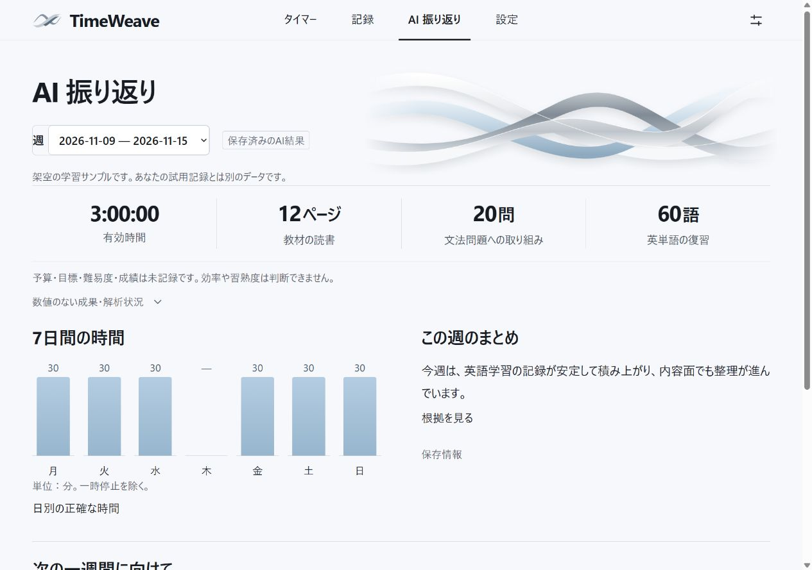

# TimeWeave

取り組んだ時間と実際にできたことを記録し、自分の行動を振り返るためのツールです。「時間だけでは、何が進んだか分かりにくい」という身近な課題から生まれました。

**[公開デモを開く](https://wk1499456234-glitch.github.io/time-management-showcase/)** · [中文说明](README.zh-CN.md)

画像は公開版 `a764226` で収録したブラウザー画面です。四ページ構成と固定例の紹介に用いており、本更新の実機検証画像ではありません。現在の細部は公開デモをご確認ください。

## はじめに使う

1. **[タイマー](https://wk1499456234-glitch.github.io/time-management-showcase/#/timer)**で活動を選び、「開始」を押します。一時停止・再開・終了ができ、一時停止中の時間は有効時間に含めません。
2. 計測中に、学んだことや完成した量を入力して「成果を保存」を押します。この原文を **Output** と呼びます。「英単語を20語復習した」のような数量のある記録も、理解したことのメモも残せます。
3. **[記録](https://wk1499456234-glitch.github.io/time-management-showcase/#/records)**で「自分の試用記録」を開き、終了した活動の原文を確認・編集します。「架空の学習サンプル」に切り替えると、整理された成果、数量、単位、元のAI解析と人による確認内容を読めます。固定例は編集できません。
4. **[AI 振り返り](https://wk1499456234-glitch.github.io/time-management-showcase/#/review)**で週を選びます。固定例の時間分布と成果の比較を見て、保存済みの説明・提案から「根拠を見る」を開きます。AI結果がない週は統計のみ表示します。
5. **[設定](https://wk1499456234-glitch.github.io/time-management-showcase/#/settings)**で日本語／中文の切り替えと、試用記録のJSONバックアップ・読み込みを行います。

## 公開デモとフル版の違い

| 機能 | この公開デモ | 別環境のフル版 |
| --- | --- | --- |
| 計時・成果の原文・原文編集 | 利用できる。このブラウザーに保存 | ログインしたアカウントごとにサーバーへ保存 |
| AIによる成果の整理 | 保存済みの固定例を閲覧。新しい入力は送信しない | 許可・設定が有効なとき、新規原文の保存後に非同期で解析 |
| 成果の修正・分類の確認 | 固定例の確認内容を閲覧 | 内容・数量・単位を修正。新しい正式分類は利用者が明示的に確認 |
| 週の統計・AI振り返り | 固定5週の統計と、対象週の保存済み日本語結果 | 利用者の記録を集計し、操作によって生成・更新 |
| バックアップ | 試用記録のJSON | 原始記録のJSONと、管理者によるSQLite完全バックアップ |
| 端末間の利用 | 自動同期なし | 同じサーバー・アカウントへの接続が必要 |

フル版のバックエンドはこの公開リポジトリに含まれません。AIは現在、権限・設定・費用の取り決めに基づき主に作者本人が利用しています。組織での利用には、認証、保存先、モデルの利用権限と費用負担の確認・接続検証が必要です。

## 保存とAIについて

**自分の試用記録と、架空の固定例は別のデータです。** 公開デモは訪問者の入力をサーバーやAIへ送信せず、固定の振り返りをその入力の分析として表示しません。閲覧、再読み込み、言語切り替えでAI費用は発生しません。保存済みAI結果は日本語のまま読みます。

試用記録はブラウザーに保存されます。別の端末へは自動同期されず、サイトデータを消すと失われます。消去や移動の前に設定からJSONを書き出してください。読み込みは件数を確認してから実行し、同一記録は重複させず、内容の衝突は拒否します。

保存エラー時はページを閉じず、「同じ保存を再試行」するかJSONを書き出してください。メモリーに残った内容は、再保存が成功するまでは永続保存済みではありません。

AIの提案は記録を考えるための材料です。復習量から習得度、解答量から正答率は判断できません。目標・難易度・成績などがない場合は判断を留保します。時間は活動全体の値で、成果ごとの所要時間を推定しません。

## 技術と関連資料

公開版はReact・TypeScript・Viteによる静的アプリです。GitHub Pagesで配信し、訪問者の記録にはブラウザー保存を使います。日付・時刻・日次集計は日本時間（Asia/Tokyo）、週は月曜始まりです。

| 資料 | 内容 |
| --- | --- |
| [要件定義書](docs/REQUIREMENTS.md) | 利用場面、実装範囲、受け入れ条件 |
| [記録・集計定義書](docs/RECORD-DEFINITION.md) | 原文と成果、時間、数量、比較の意味 |
| [設計書](docs/DESIGN.md) | ページ、保存と復旧、データの分離 |
| [AIを活用した開発の経験と変更記録](docs/DEVELOPMENT-PROGRESS.md) | 六つの経験と現在の開発状態 |
| [開発手順・作業再開ガイド](docs/DEVELOPMENT-WORKFLOW.md) | 作業手順、役割、別のチャットでの再開 |
| [検証記録](docs/VALIDATION.md) | バージョン別の確認結果と未確認事項 |
| [ビルド・公開・復旧](DEPLOYMENT.md) | 公開手順と正式リソースの確認 |
| [出典・来歴](PROVENANCE.md) | コード、画像、固定データ、AI結果の由来 |
