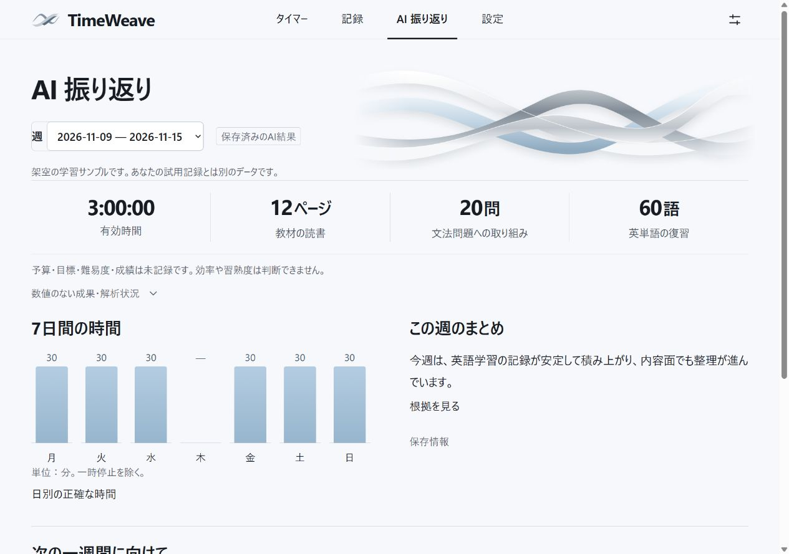

# TimeWeave

记录投入的时间和实际完成的内容，帮助回顾自己的行动。它源于一个日常问题：只知道花了多久，还不容易看清做成了什么。

**[打开公开演示](https://wk1499456234-glitch.github.io/time-management-showcase/)** · [日本語](README.md)

这张浏览器截图收录于公开版 `a764226`，用于介绍四页结构与固定示例，并非本轮实机验收截图。当前细节以公开页面为准。

## 开始使用

1. 在[计时](https://wk1499456234-glitch.github.io/time-management-showcase/#/timer)页选择活动并开始，按需暂停、恢复、结束。有效时间不包含暂停区间。
2. 计时中输入学到了什么、完成了多少，点击“保存成果”。这份原文称为 **Output**，可以包含数量，也可以只记录理解和思考。
3. 在[记录](https://wk1499456234-glitch.github.io/time-management-showcase/#/records)页查看“我的试用记录”，展开已结束活动并编辑原文。切换到“虚构学习示例”可查看整理成果、数量、单位、原始AI解析及人工确认内容。固定示例只读。
4. 在[AI 回顾](https://wk1499456234-glitch.github.io/time-management-showcase/#/review)页选择示例周，查看时间分布、成果比较和已保存的解释、建议，展开依据。没有保存AI结果的周只显示统计。
5. 在[设置](https://wk1499456234-glitch.github.io/time-management-showcase/#/settings)页切换中日文、导出或读取试用记录的JSON备份。

## 公开演示与完整版

| 功能 | 当前公开演示 | 独立环境中的完整版 |
| --- | --- | --- |
| 计时、Output原文、原文编辑 | 可用，保存在当前浏览器 | 登录后按账号保存到服务端 |
| AI结构化解析 | 读取固定示例，不发送新输入 | 权限与配置允许时，新原文保存后异步解析 |
| 成果修正与分类确认 | 查看固定示例的确认内容 | 修正内容、数量、单位；用户明确确认新增正式分类 |
| 周统计与AI回顾 | 固定五周统计及目标周已保存的日文结果 | 按用户记录统计，由用户主动生成、更新 |
| 备份 | 试用记录JSON | 原始记录JSON，以及管理员执行的SQLite完整备份 |
| 跨设备 | 不自动同步 | 需要连接同一服务并使用同一账号 |

完整版后端不包含在这个公开仓库中。目前AI主要由作者本人按现有权限、调用配置与费用安排使用。供组织使用时，仍需确认认证、存储、模型权限和费用承担，并完成接入验收。

## 保存与AI范围

**访客试用记录与虚构固定示例相互独立。** 公开版不把访客输入发送给服务端或AI，也不把固定回顾当作新输入的分析。打开页面、刷新、切换语言不会产生AI费用。已保存的AI结果保留日文，不冒充中文生成结果。

试用记录只在当前浏览器保存，不自动跨设备同步。清除网站数据或更换设备前请导出JSON。导入会先预览数量，再合并相同记录；重复记录不追加，内容冲突会被拒绝。

保存失败时不要关闭页面，请使用“重试同一保存”或导出JSON。仅保留在内存中的内容，在重试成功前不算已持久保存。

AI建议用于辅助思考。复习数量不等于掌握程度，作答数量不等于正确率；缺少目标、难度、成绩等信息时应保留判断。时间属于整次活动，不推算单条成果的专属耗时。

## 技术与相关资料

公开版使用React、TypeScript、Vite，静态部署到GitHub Pages，访客记录使用浏览器保存。日期、时刻与每日统计统一采用Asia/Tokyo，每周从周一开始。

以下资料以日文维护，避免重复维护不同版本的定义：

| 资料 | 内容 |
| --- | --- |
| [需求定义](docs/REQUIREMENTS.md) | 使用场景、功能范围、验收条件 |
| [记录与统计定义](docs/RECORD-DEFINITION.md) | 原文、成果、时间、数量和比较规则 |
| [设计说明](docs/DESIGN.md) | 页面、保存恢复及数据分离 |
| [AI开发经验与变更记录](docs/DEVELOPMENT-PROGRESS.md) | 六类经验和当前状态 |
| [开发流程与跨聊天接续](docs/DEVELOPMENT-WORKFLOW.md) | 操作流程、职责与工作恢复 |
| [验证记录](docs/VALIDATION.md) | 各版本的实际结果和未验证项 |
| [构建、发布与恢复](DEPLOYMENT.md) | 发布步骤及正式资源核对 |
| [来源说明](PROVENANCE.md) | 代码、图片、固定数据及AI结果来源 |
